<p align="center">
  
</p>

<h1 align="center">Lexodle</h1>

<p align="center">
  A word game that shows you how well you played.<br>
  17 languages, a daily word, four boards at once, and a score for every guess.
</p>

<p align="center">
  <a href="https://github.com/aaronified/lexodle/releases/latest"></a>
  <a href="https://github.com/aaronified/lexodle/releases/latest"></a>
  <a href="https://github.com/aaronified/lexodle/releases"></a>
  <a href="https://aaronified.github.io/lexodle/"></a>
  
  <a href="https://flutter.dev"></a>
  <a href="LICENSE"></a>
</p>

<p align="center">
  <a href="https://github.com/aaronified/lexodle/actions/workflows/pages.yml"></a>
  <a href="https://github.com/aaronified/lexodle/actions/workflows/release.yml"></a>
</p>

<p align="center">
  <a href="https://aaronified.github.io/lexodle/"><strong>Try the demo</strong></a> ·
  <a href="https://github.com/aaronified/lexodle/releases/latest"><strong>Get the Android APK</strong></a> ·
  <a href="https://github.com/aaronified/lexodle/wiki">Wiki</a> ·
  <a href="docs/paper">The maths</a>
</p>

---

<table>
  <tr>
    <td align="center">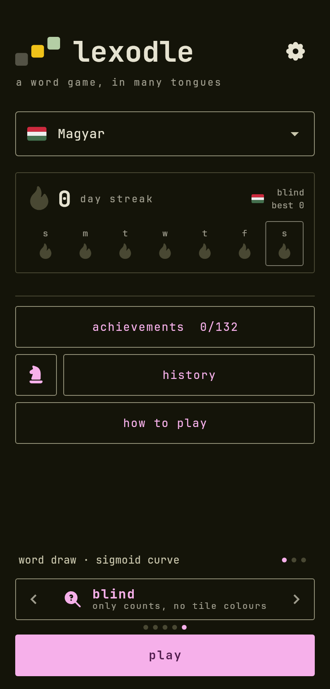</td>
    <td align="center">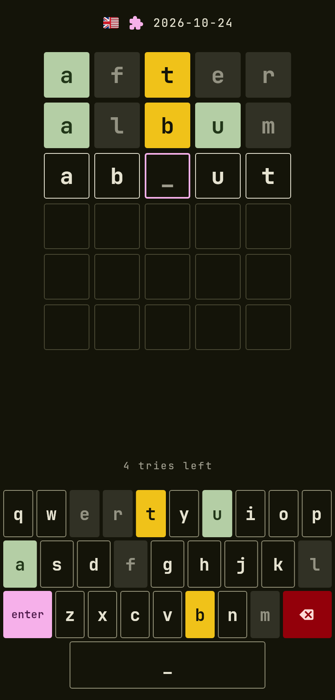</td>
    <td align="center">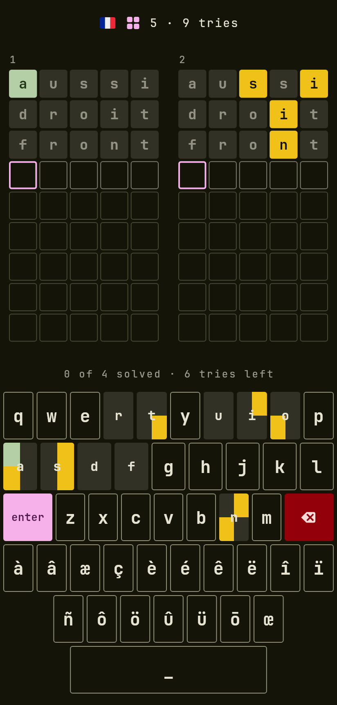</td>
  </tr>
</table>

## What it does

<table>
  <tr>
    <td width="60%">
      <h3>📅 A daily word, in every language</h3>
      Everyone gets the same word on the same date, with no server picking it. Each language has
      its own streak and calendar, and the day is checked against the hosting server's clock so
      the device date cannot be wound forward.
      <a href="https://github.com/aaronified/lexodle/wiki/Daily-word">How it works</a>.
    </td>
    <td width="40%"></td>
  </tr>
</table>

<table>
  <tr>
    <td width="40%"></td>
    <td width="60%">
      <h3>🔢 Four words at once</h3>
      A quartet plays one guess on four boards, each key split in four. A relay race plays the
      boards one after the other, each starting with every earlier guess applied. Pick the word
      length (4 to 8), the tries and how common the answers are.
      <a href="https://github.com/aaronified/lexodle/wiki/How-to-play">The rules</a>.
    </td>
  </tr>
</table>

<table>
  <tr>
    <td width="60%">
      <h3>🔒 Lockdown</h3>
      One word and six tries, with hearts: 10, 7, 5, 3 or 1. A letter in the right place locks
      and stays locked, and a word that is not in the list costs a heart, which breaks with a
      rumble and a crack. The last three hearts throb. It has a daily of its own.
      <a href="https://github.com/aaronified/lexodle/wiki/How-to-play">The rules</a>.
    </td>
    <td width="40%">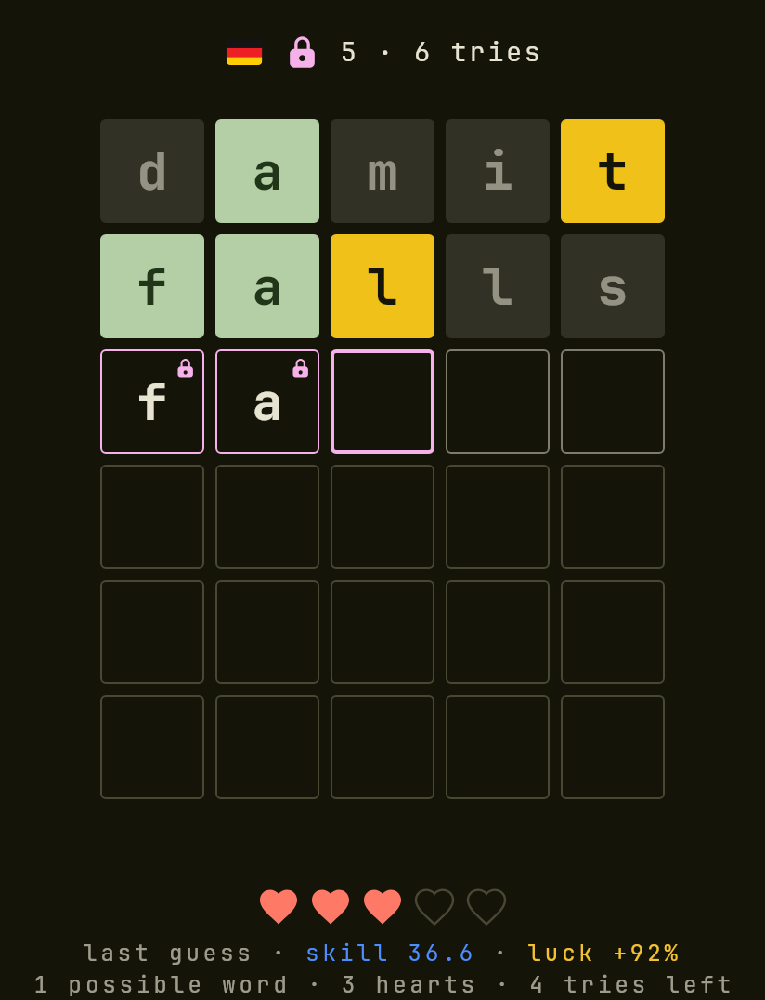</td>
  </tr>
</table>

<table>
  <tr>
    <td width="40%">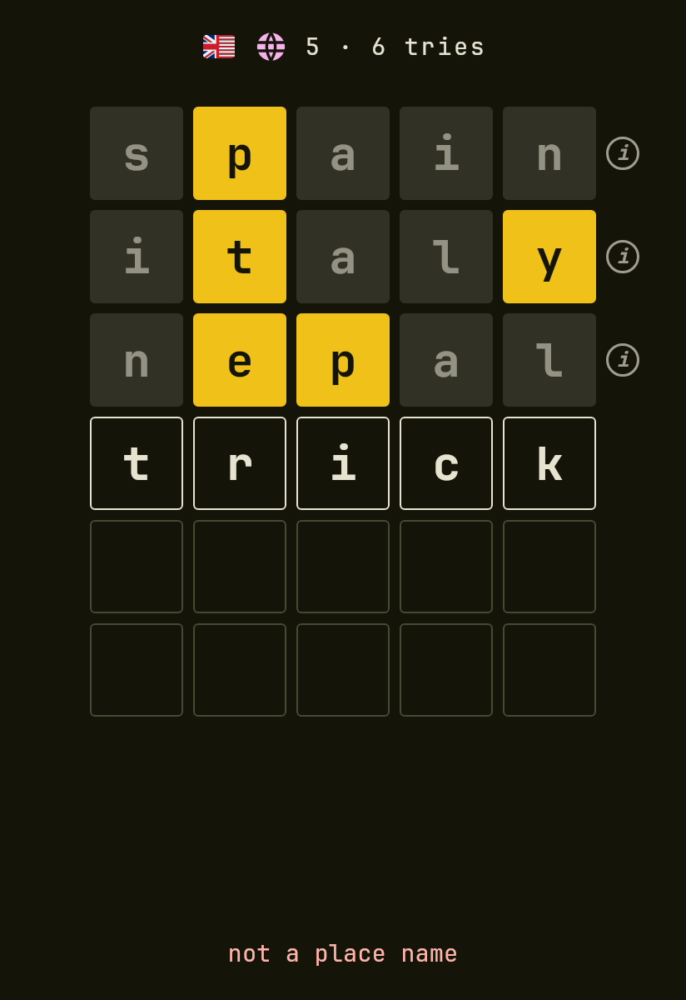</td>
    <td width="60%">
      <h3>🌍 Themed: geography</h3>
      Place names in English only: countries, cities, rivers, mountains, lakes and bays, in their short
      and long forms (<code>indus</code> and Indus River). Only places are valid guesses, the answer is
      drawn by how well known a place is (or from every place), and every guess has an info dot with
      what it is and a link to Wikipedia. More themes are on the way.
      <a href="https://github.com/aaronified/lexodle/wiki/How-to-play">The rules</a>.
    </td>
  </tr>
</table>

<table>
  <tr>
    <td width="60%">
      <h3>🔍 Blind, and 🎁 make your own</h3>
      <b>Blind</b> shows only how many letters are right and in place, and how many are right elsewhere,
      in every language; tap a letter of a guess to pencil a colour on it. <b>Make your own</b> turns
      any word into a link that others play as practice. Every mode is in the swipe on the home screen.
    </td>
    <td width="40%">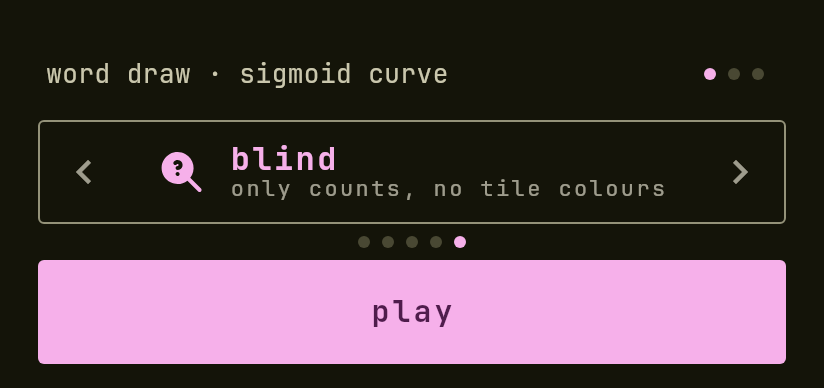</td>
  </tr>
  <tr>
    <td width="40%">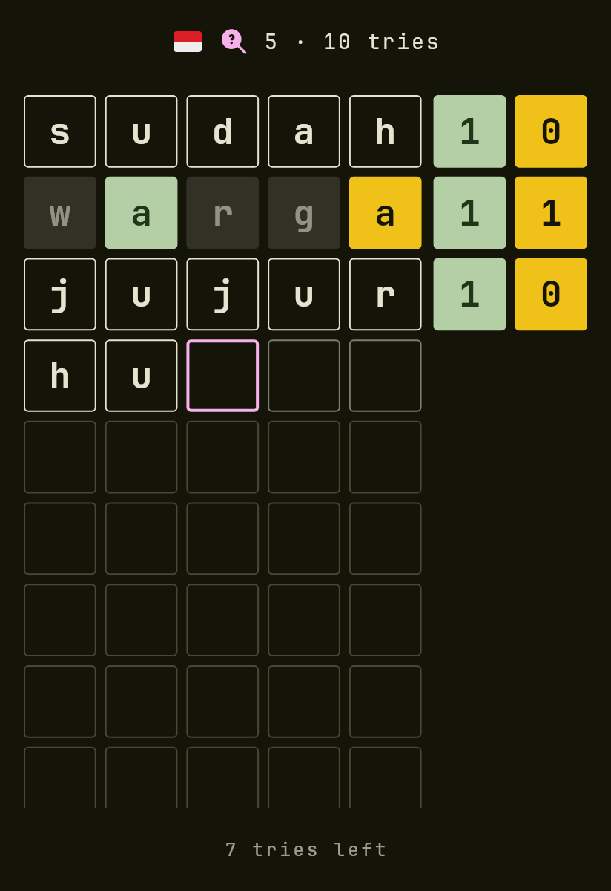</td>
    <td width="40%">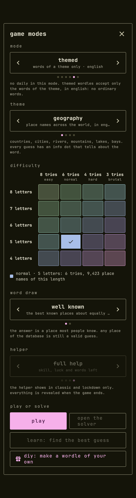</td>
  </tr>
</table>

<table>
  <tr>
    <td width="40%">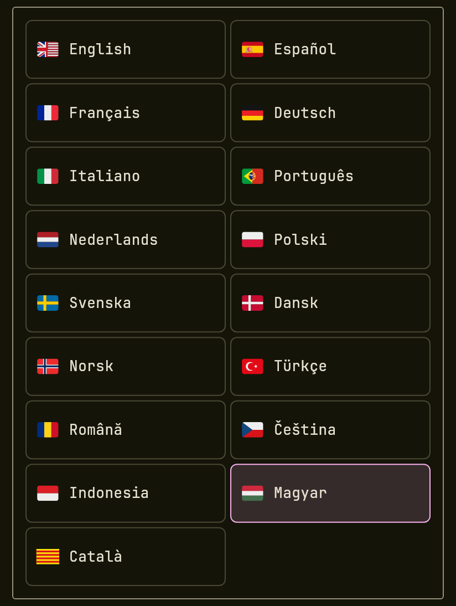</td>
    <td width="60%">
      <h3>🌐 Seventeen languages</h3>
      English, Spanish, French, German, Italian, Portuguese, Dutch, Polish, Swedish, Danish,
      Norwegian, Turkish, Romanian, Czech, Indonesian, Hungarian and Catalan, each with its own
      word list, keyboard letters, daily, streak and achievements.
      <a href="https://github.com/aaronified/lexodle/wiki/Languages">The languages</a>.
    </td>
  </tr>
</table>

<table>
  <tr>
    <td width="60%">
      <h3>🎯 Every guess is scored</h3>
      <b>Skill</b> says how many bits the guess was expected to gain, <b>luck</b> how the answer fell,
      and <b>risk</b> how far you leaned on a rare big gain. The review steps
      through your game against the best picks at each point.
      <a href="https://github.com/aaronified/lexodle/wiki/Skill-luck-and-risk">What the numbers mean</a>.
    </td>
    <td width="40%">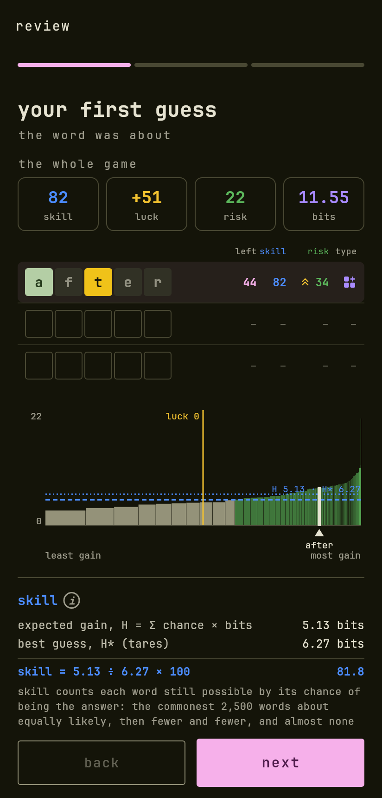</td>
  </tr>
</table>

<table>
  <tr>
    <td width="40%">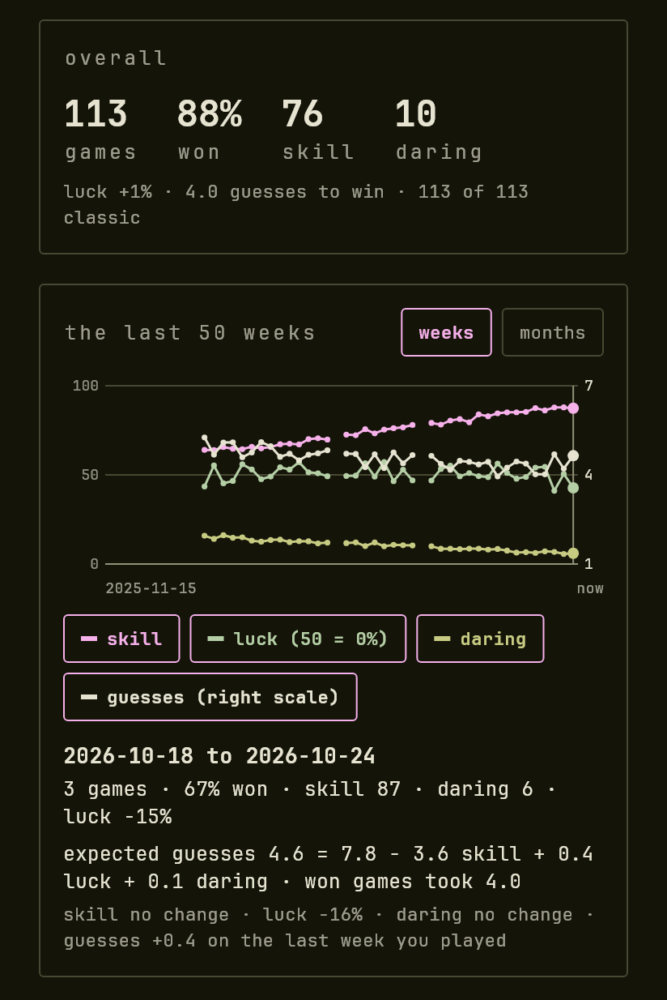</td>
    <td width="60%">
      <h3>📈 A history that explains your play</h3>
      Every game is kept, however many, with a chart over the last 50 weeks or months of skill,
      luck and risk.
      <a href="https://github.com/aaronified/lexodle/wiki/History-and-playstyles">History</a>.
    </td>
  </tr>
</table>

<table>
  <tr>
    <td width="60%">
      <h3>🎭 Six playstyles</h3>
      From analyst to gambler: an early habit (maximiser, eliminator or gambler) and an end habit
      (prober or closer), read from how each guess scored. It moves as you play, and each language has its own.
      <a href="https://github.com/aaronified/lexodle/wiki/History-and-playstyles#playstyles">The six</a>.
    </td>
    <td width="40%">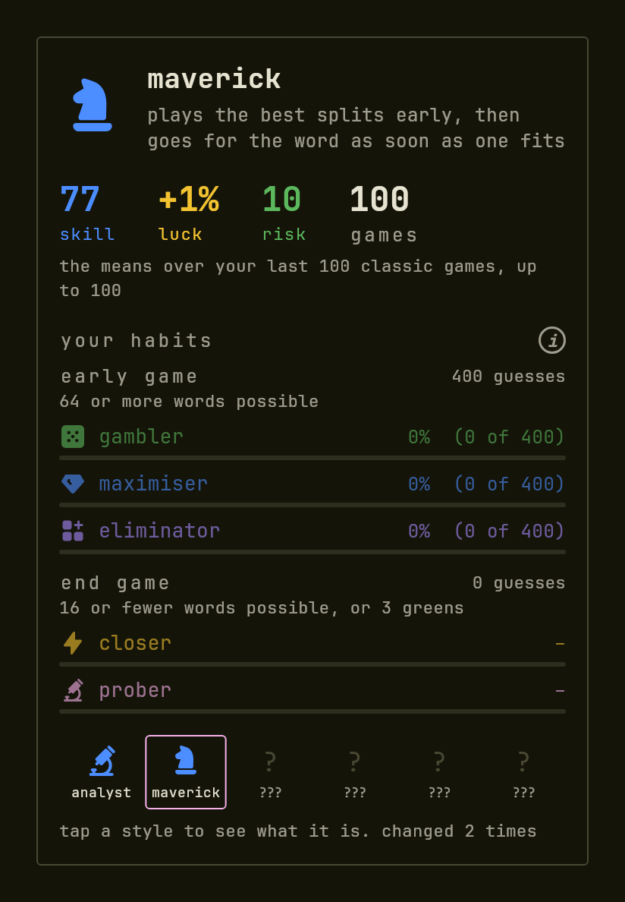</td>
  </tr>
</table>

<table>
  <tr>
    <td width="40%">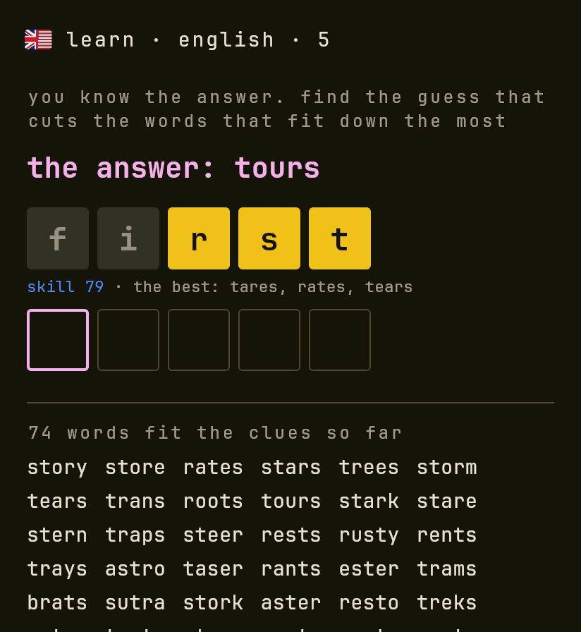</td>
    <td width="60%">
      <h3>🎓 Learn mode</h3>
      The answer is shown. Find the guess that cuts the words left the most; each guess is graded
      against the best, and the words that still fit are listed at the bottom.
    </td>
  </tr>
</table>

<table>
  <tr>
    <td width="60%">
      <h3>🧩 A solver for games played elsewhere</h3>
      Type the guesses, tap the colours the other game showed, and get the words left and the next
      guess, aware of the tries you have. It handles the quartet and the relay race too.
      <a href="https://github.com/aaronified/lexodle/wiki/Solver-and-learn-mode">Solver and learn mode</a>.
    </td>
    <td width="40%">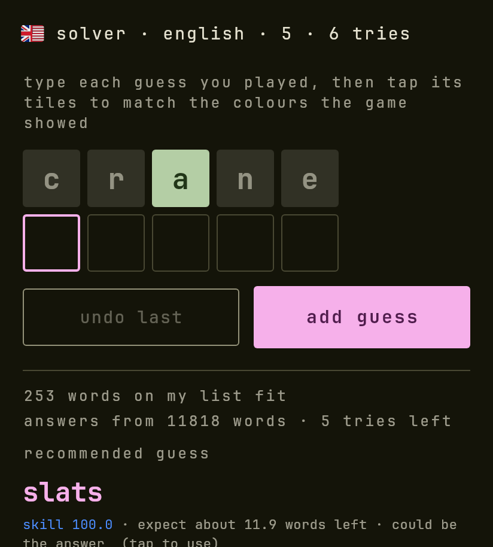</td>
  </tr>
</table>

<table>
  <tr>
    <td width="40%">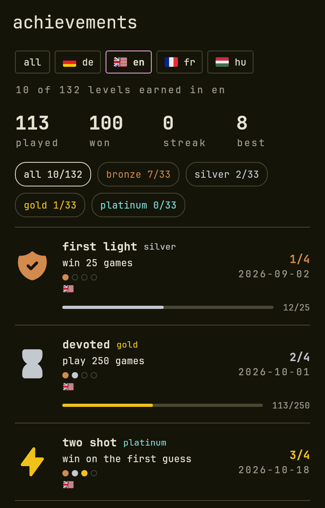</td>
    <td width="60%">
      <h3>🏅 Achievements, by language</h3>
      49 achievements, each earned in a language and wearing its flag, with an all-languages
      view and a tower of babel for completing every language; the ones that count
      languages wear theirs. Playstyle, streak and history are kept per language too.
      <a href="https://github.com/aaronified/lexodle/wiki/Languages">Languages</a> ·
      <a href="https://github.com/aaronified/lexodle/wiki/Achievements">Achievements</a>.
    </td>
  </tr>
</table>

**And also:** an in-app update check for the Android app, a UPI donation button, blanks you can pencil in, a backup file for everything, light and dark themes, and nothing
fetched to draw: fonts, flags and icons are in the app
([offline and privacy](https://github.com/aaronified/lexodle/wiki/Offline-and-privacy)).

## Run it

```
cd app
flutter pub get
flutter test
flutter run -d chrome
```

`flutter build apk` also works; a version tag (`v0.1.0`) makes the [release workflow](.github/workflows/release.yml) build and attach the APK. The [wiki](https://github.com/aaronified/lexodle/wiki) has the file map,
how the [word lists](https://github.com/aaronified/lexodle/wiki/Word-lists) are built, the screenshots and the
deploy ([developing](https://github.com/aaronified/lexodle/wiki/Developing)); the
[paper](docs/paper) has the maths of skill, luck and risk in bits, with its simulations.

## Credits

Words from [wordfreq](https://github.com/rspeer/wordfreq) filtered with Hunspell dictionaries;
meanings from [Wiktionary](https://en.wiktionary.org); JetBrains Mono; [Tabler](https://tabler.io/icons)
icons; [Twemoji](https://github.com/jdecked/twemoji) flags. Licences are in
[the wiki](https://github.com/aaronified/lexodle/wiki/Word-lists#credits-and-licences) and the code is under [LICENSE](LICENSE).
