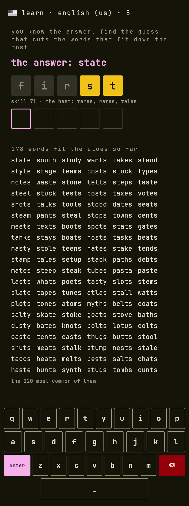
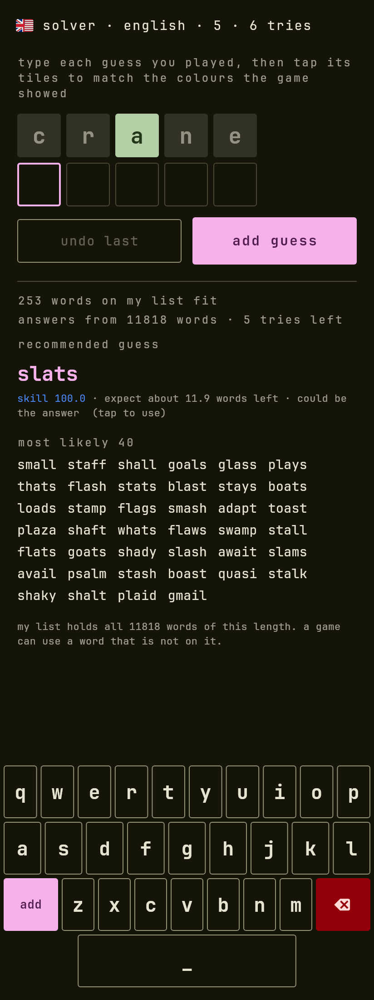
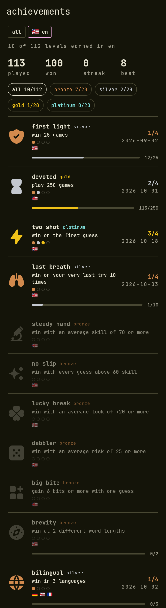

<p align="center">
  
</p>

<h1 align="center">Lexodle</h1>

<p align="center">
  A word game that shows you how well you played.<br>
  17 languages, a daily word, four boards at once, and a score for every guess.
</p>

<p align="center">
  <a href="https://github.com/aaronified/lexodle/actions/workflows/pages.yml"></a>
  <a href="LICENSE"></a>
</p>

<p align="center">
  <a href="https://aaronified.github.io/lexodle/"><strong>Play it</strong></a> ·
  <a href="https://github.com/aaronified/lexodle/wiki">Wiki</a> ·
  <a href="docs/paper">The maths</a>
</p>

---

<table>
  <tr>
    <td align="center"></td>
    <td align="center"></td>
    <td align="center"></td>
  </tr>
  <tr>
    <td align="center"></td>
    <td align="center"></td>
    <td align="center"></td>
  </tr>
</table>

## What it does

<table>
  <tr>
    <td width="60%">
      <h3>📅 A daily word, in every language</h3>
      Everyone gets the same word on the same date, with no server picking it. Each language has
      its own streak and calendar, and the day is checked against the hosting server's clock so
      the device date cannot be wound forward.
      <a href="https://github.com/aaronified/lexodle/wiki/Daily-word">How it works</a>.
    </td>
    <td width="40%"></td>
  </tr>
</table>

<table>
  <tr>
    <td width="40%"></td>
    <td width="60%">
      <h3>🔢 Four words at once</h3>
      A quartet plays one guess on four boards, each key split in four. A relay race plays the
      boards one after the other, each starting with every earlier guess applied. Pick the word
      length (4 to 8), the tries and how common the answers are.
      <a href="https://github.com/aaronified/lexodle/wiki/How-to-play">The rules</a>.
    </td>
  </tr>
</table>

<table>
  <tr>
    <td width="60%">
      <h3>🎯 Every guess is scored</h3>
      <b>Skill</b> says how well the guess split the words left, <b>luck</b> how the answer fell,
      and <b>daring</b> how far you went for the word instead of the clues. The review steps
      through your game against the best picks at each point.
      <a href="https://github.com/aaronified/lexodle/wiki/Skill-luck-and-daring">What the numbers mean</a>.
    </td>
    <td width="40%"></td>
  </tr>
</table>

<table>
  <tr>
    <td width="40%"></td>
    <td width="60%">
      <h3>📈 A history that explains your play</h3>
      Every game is kept, however many, with a chart over the last 50 weeks or months of skill,
      luck, daring and the guesses a game is expected to take, broken into what each contributed.
      Six playstyles, from analyst to wildcard, are read from how you play.
      <a href="https://github.com/aaronified/lexodle/wiki/History-and-playstyles">History and playstyles</a>.
    </td>
  </tr>
</table>

<table>
  <tr>
    <td width="60%">
      <h3>🎓 Learn mode</h3>
      The answer is shown. Find the guess that cuts the words left the most; each guess is graded
      against the best, and the words that still fit are listed at the bottom.
    </td>
    <td width="40%"></td>
  </tr>
</table>

<table>
  <tr>
    <td width="40%"></td>
    <td width="60%">
      <h3>🧩 A solver for games played elsewhere</h3>
      Type the guesses, tap the colours the other game showed, and get the words left and the next
      guess, aware of the tries you have. It handles the quartet and the relay race too.
      <a href="https://github.com/aaronified/lexodle/wiki/Solver-and-learn-mode">Solver and learn mode</a>.
    </td>
  </tr>
</table>

<table>
  <tr>
    <td width="60%">
      <h3>🏅 Achievements, by language</h3>
      47 achievements, each earned in a language and wearing its flag; the ones that count
      languages wear theirs. Playstyle, streak and history are kept per language too.
      <a href="https://github.com/aaronified/lexodle/wiki/Languages">Languages</a> ·
      <a href="https://github.com/aaronified/lexodle/wiki/Achievements">Achievements</a>.
    </td>
    <td width="40%"></td>
  </tr>
</table>

**And also:** blanks you can pencil in, a backup file for everything, light and dark themes, and nothing
fetched to draw: fonts, flags and icons are in the app
([offline and privacy](https://github.com/aaronified/lexodle/wiki/Offline-and-privacy)).

## Run it

```
cd app
flutter pub get
flutter test
flutter run -d chrome
```

`flutter build apk` also works. The [wiki](https://github.com/aaronified/lexodle/wiki) has the file map,
how the [word lists](https://github.com/aaronified/lexodle/wiki/Word-lists) are built, the screenshots and the
deploy ([developing](https://github.com/aaronified/lexodle/wiki/Developing)); the
[paper](docs/paper) has the maths of skill, risk, luck and daring with its experiments.

## Credits

Words from [wordfreq](https://github.com/rspeer/wordfreq) filtered with Hunspell dictionaries;
meanings from [Wiktionary](https://en.wiktionary.org); JetBrains Mono; [Tabler](https://tabler.io/icons)
icons; [Twemoji](https://github.com/jdecked/twemoji) flags. Licences are in
[the wiki](https://github.com/aaronified/lexodle/wiki/Word-lists#credits-and-licences) and the code is under [LICENSE](LICENSE).
