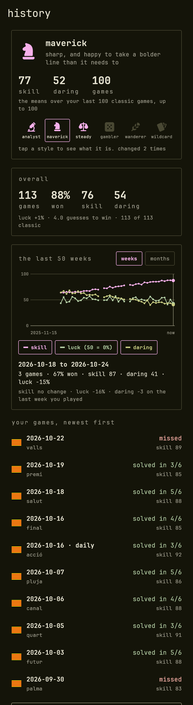
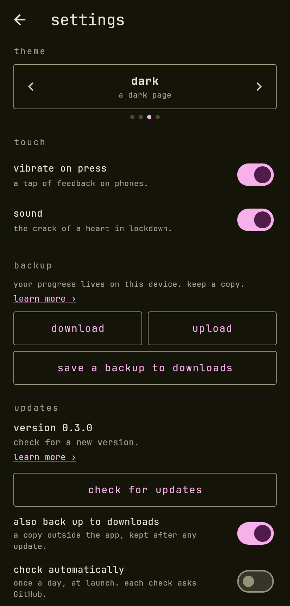

<p align="center">
  
</p>

# Lexodle

A minimal word game in 17 Latin-script languages.

**Play: <https://aaronified.github.io/lexodle/>**

<table>
  <tr>
    <td align="center"><br><sub>home: language, daily streak, difficulty, playstyle</sub></td>
    <td align="center"><br><sub>the daily, with a blank pencilled in</sub></td>
    <td align="center"><br><sub>quartet: four words, one set of guesses</sub></td>
  </tr>
  <tr>
    <td align="center"><br><sub>review: skill and luck, step by step</sub></td>
    <td align="center"><br><sub>history: playstyle, how play changed, your games</sub></td>
    <td align="center"><br><sub>settings</sub></td>
  </tr>
</table>

(Taken from the real screens by a test, so they can be taken again: see
[Screenshots](#screenshots) below.)

## How to play

Guess the hidden word. After each guess every letter is marked:

- **green** – right letter, right place
- **yellow** – in the word, wrong place
- **grey** – not in the word

Before you start, choose:

| Setting    | Options                                                                  |
| ---------- | ------------------------------------------------------------------------ |
| Language   | English (US and UK spelling), Spanish, French, German, Italian, Portuguese (Brazil and Portugal), Dutch, Polish, Swedish, Danish, Norwegian, Turkish, Romanian, Czech, Indonesian, Hungarian, Catalan; each with its flag |
| Letters    | 4 to 8                                                                   |
| Difficulty | a grid: tries (easy 8, normal 6, hard 4, brutal 3) by word pool: answers drawn from the 500, 1,500, 3,000 or 6,000 most common words of that length. A pool level is offered only if the language has at least 1,000 more words of that length than the level below it, and the last level offered takes every word left, so none is wasted: English at five letters has 4,994 words, so its "obscure" row is all 4,994; Danish and Indonesian never get "obscure" |

The letters and the helper are sliders: use the arrows, swipe or drag (the value slides and
fades with your finger), scroll sideways or hold shift and scroll the wheel, or click one and use
the arrow keys. Type on a keyboard or use the on-screen one, which adds each language's accented
letters. The up and down arrow keys scroll whatever the mouse is over, as the wheel does.

**Blanks.** Not sure of a letter? Type a blank with the `_` key (or the space bar) to pencil in a
pattern like `a_ode`. Tap a tile, or use the left and right arrow keys, to move the cursor; typing
fills the selected tile and moves on to the next one that is not a letter. A blank can be typed
but not submitted, so it never reaches the scoring.

### Skill and luck

The **helper** setting chooses what the game tells you while you play: *off*,
*skill only*, *skill + luck*, or *full help* (which adds how many possible words remain).
When a game ends, the **review** steps through your guesses one at a time (buttons,
the progress bar, or the arrow keys). Each step shows the board with a table of skill,
luck, words left and info gained; your guess beside the best picks at that point; how
the guess divided the pool of possible words, against the pool you landed in; and a
short reading of the step. Your guess can be a valid word that the game never uses as an
answer; the review says so, and nothing more.

With *N* words still possible, a guess splits them into groups by the feedback they
would give; the expected pool left is *E* = Σ(group size)² / *N*. The maths, with proofs, is in
[`docs/paper`](docs/paper).

- **skill** = ln(*N* / *E*) / ln(*N* / *E*\*) × 100, where *E*\* is the smallest *E* any real
  guess reaches. 100 means as good as the best real guess, 0 means the guess tells you
  nothing. The logarithm keeps most guesses from crowding near 100. With one word left,
  playing it is 100 and anything else 0. Skill shows as dots until the best real guess has been
  found in the background.
- **luck**, from −100% to +100%: the chance of landing in a bigger pool than you did, less the
  chance of landing in a smaller one. 0% is the middle outcome, and over every possible answer
  it averages exactly 0. On the last try only a word that fits the clues can win, so luck is
  then about the pick itself.
- **daring**, from 0 to 100: how much your guess went for the whole word instead of the clues. A
  guess that cannot be the answer has none. One that can scores higher the more it cost in skill,
  the less likely that word was (by how common it is), and the more tries you had left. With one
  try left going for the word is the only play, so it has none; neither does a guess that is both
  the best split and a possible answer. Good players seldom go above 10.
- **info gained** = (1 − ln(words left) / ln(words at the start)) × 100, cumulative, as in
  WordleBot. It reaches 100% when one word is left.

Skill, luck and daring are all worked out from the guesses alone, so they can be worked out
again if the maths changes (see History).

### Solver

The **solver** (open it from the settings, beside play) helps with a game you are playing
elsewhere. It uses the same settings as the game: the language, the letters and the difficulty
(the answer is one of the words of the chosen pool, and it counts the tries). Type each guess, tap
its tiles to match the colours the game showed (grey, yellow, green), and add it. It lists the
words still possible, most likely first, and recommends the next guess: the word that leaves the
fewest words in expectation, drawn from the 600 most frequent words plus the possible answers.
Tap a word to use it as the next guess. Guesses are scored over every word the game accepts
(up to 6,000 per length), while the answer is looked for in the pool, so raise the pool if the
game you are solving uses rarer words.

When a game ends, the answer's pronunciation (IPA and audio), meaning, synonyms
and antonyms are fetched from [Wiktionary](https://en.wiktionary.org), with a
link to the full entry. If Wiktionary has no entry or is unreachable, the game
carries on without it.

### Modes

**Classic** is one word. In a **quartet** four words are hidden and every guess is played on all
four boards at once (the keyboard splits each key in four, one part per board); a **relay race**
plays the four boards one after the other, each starting with every earlier guess already
applied. Quartet and relay race get extra tries, and the *shared letters* setting says how often
their words may share a letter. The helper shows in classic only, so it is greyed out for the
others, and shared letters is greyed out in classic.

### Daily word

Everyone gets the same word on the same date, in every language: the date and the language are
hashed to pick one word of the 3,000-word pool, with no server involved. A daily is always five
letters and six tries, whatever the settings say. It is saved as you go, so closing the page
cannot reroll it, and it is played once a day.

- **The day** is the player's own calendar date, changing at their local midnight.
- **The clock.** So that the device clock cannot be set to another day, the app asks the server it
  is hosted on for the time (the `Date` header of one request, nothing else, no other service)
  when it starts, and again before opening the daily if the last answer is over ten minutes old.
  After that the time moves on by a monotonic clock that the player cannot change, so changing the
  device date afterwards does nothing. **If the server cannot be reached, the system time is used**,
  quietly, so the daily still plays offline. Anything saved on the device can of course still be
  edited by the person who owns it.
- **The streak** counts the days in a row on which a daily was solved, in any language. A day not
  played yet does not break it; a day missed does. The home page shows it as a fire with the week
  (Monday first). A **double fire** is a daily solved in three guesses or fewer, or with every guess
  at 80 skill or more.

### History and playstyles

Every finished game is kept (up to 10,000) as two tables, so that nothing is lost if the maths
changes: a row per game (when, language, mode, length, tries, pool, the answers, won, the daily
date) and a row per guess (the word, with its skill, luck, daring, risk and pool sizes cached
under the version of the maths that made them). The guesses are the facts; the scores can be
thrown away and worked out again, which happens, game by game, newest first, when the history is
opened after the maths has changed (a game scored with older maths counts as played but is left
out of the averages until then). Rows are compact lists, and are saved a month at a time, so
finishing a game rewrites one month, not the whole record. The history is in the backup.

The **history** page (tap your playstyle on the home screen) has:

- your playstyle, and what it is read from;
- an **overall** analysis of every game, however many (games, won, skill, daring, luck, guesses to
  win);
- **how play changed**: a line each for skill, luck and daring over the last 50 weeks (rolling
  seven-day windows ending today) or the last 50 months, with a gap where nothing was played. Tap
  or drag along it to pick a period and see its games, its numbers, the change on the last period
  you played, and the playstyle that period alone would have. Luck is drawn about the middle line,
  which is a luck of 0%;
- your games, newest first: **the last ten, and "load 10 more" as you need them**. Each opens its
  review, rebuilt from the guesses alone.

Your **playstyle** is read from your last 100 classic games (a daily is one): the means of skill
and of daring (how much you go for the word itself) over the guesses that had a choice to make, once you have 10 games. Skill gives three
tiers (loose, solid, sharp) and daring splits each in two, which makes six styles, each with an
icon shown on the home page:

|           | careful   | bold     |
| --------- | --------- | -------- |
| **sharp** | analyst   | maverick |
| **solid** | steady    | gambler  |
| **loose** | wanderer  | wildcard |

It moves as you play, and a margin around the line keeps one game either side of it from
changing your style. The thresholds come from simulated players of seven habits played through the
app's own maths, in [`docs/paper`](docs/paper) (Section 9.5, and 9.6 for how daring predicts the tries); they are **not measured on people
yet**, and skill is not comparable across word lengths, so treat the style as a first reading.

### Achievements

47 achievements, each with its own icon, saved in your browser (nothing is sent
anywhere): first light, one shot, last breath, no mercy, brevity, long haul, **pure
skill** (win with every guess above 90 skill), **skill issue** (win 10 games with every
guess above 95 skill), full range, three in a row, seven in a row, polyglot, babel,
regular, veteran, dustwalker and persistent; ones for the quartet and the relay race; language
mastery; and, for the daily, a **streak ladder** (3, 7, 14, 30, 60, 100, 200 and 365 days),
**double fire** and **twice as hot** (ten double fires). Each playstyle has one, there is one for
changing playstyle (**chameleon**) and one for having been all six (**many hats**).

Numbered achievements show a progress bar. Once earned, they start again from 0 and can
be earned again; the other achievements can be earned again too (first light aside), and
every earning is counted. A history table lists each achievement you have earned: how many
times, the first day and the latest.

## Develop

The app is in [`app/`](app) (Flutter, Material 3).

```
cd app
flutter pub get
flutter test
flutter run -d chrome
```

`flutter build apk` also works; the `android/` platform is scaffolded.

| Path                     | What it is                                              |
| ------------------------ | ------------------------------------------------------- |
| `app/lib/logic.dart`     | Guess scoring, eligible-word filter, skill, luck, risk and daring, solver recommendation, weighted word pick |
| `app/lib/solver.dart`    | The solver page                                         |
| `app/lib/keyboard.dart`  | The on-screen keyboard, shared by game and solver       |
| `app/lib/guess_input.dart` | The row a guess is typed into: slots, cursor, blanks  |
| `app/lib/words.dart`     | Loads the per-language word lists                       |
| `app/lib/difficulty.dart`| The difficulty grid and which pool levels a language offers |
| `app/lib/daily.dart`, `clock.dart` | The daily word, its streak helpers, and the trusted clock |
| `app/lib/history.dart`, `replay.dart`, `history_page.dart` | The history tables (saved a month at a time), rebuilding a game from them, and the page |
| `app/lib/analysis.dart`, `period_chart.dart` | Adding games up, overall and by week and month, and the line chart of them |
| `app/lib/playstyle.dart` | The six playstyles and how a player is placed in one    |
| `app/lib/arrow_scroll.dart` | Up and down arrow keys scroll what the mouse is over |
| `app/lib/wiktionary.dart`| Wiktionary lookup and parser                            |
| `app/lib/store.dart`     | Settings, stats and the achievement definitions         |
| `app/assets/words/`      | Generated word lists, one file per language             |
| `app/tools/`             | Word-list generator, a live Wiktionary check, and `calibrate_styles.dart` (simulated players for the playstyle thresholds) |
| `docs/paper/`            | The maths of skill, risk, luck and daring, with the experiments |
| `docs/screenshots/`      | The pictures above                                      |

`app/tools/live_check.dart` calls the real Wiktionary API (`dart run tools/live_check.dart`);
the unit tests use saved responses and need no network.

### Screenshots

The pictures at the top are taken from the real screens, rendered at phone size in a dark theme
with the app's own fonts and seeded state (a player a few weeks in, with a streak, a playstyle
and some games), so they can be taken again whenever the interface changes. It is a test that
only runs when asked:

```
cd app
LEXODLE_SCREENSHOTS=1 flutter test test/screenshots_test.dart      # PowerShell: $env:LEXODLE_SCREENSHOTS = 1
```

It writes `docs/screenshots/*.png`. A test draws every glyph as a box unless it is given the app's
fonts, so the harness loads them from files in the repository (`test/support/fonts.dart`): the
app's own font from `assets/fonts`, and a few Material icons from `test/fonts`. It reads nothing
from the Flutter SDK, the system or the network, and any test can use it.

### Nothing is fetched to draw

Everything the app draws with is in the app, so a page or a phone asks no other site for a font, an
emoji, an icon or a flag:

- **Text** is JetBrains Mono, bundled. `python app/tools/check_glyphs.py` (needs `pip install fonttools`)
  checks that it has every character the app can show: all the letters of every word list, the
  language names and the interface text. A character it lacked would be drawn from a fallback font,
  which a web page fetches from a font server.
- **Flags** are SVG files in `app/assets/flags` (the [Twemoji](https://github.com/jdecked/twemoji)
  graphics, CC BY 4.0, and the Catalan flag drawn for the project), not emoji: an emoji needs a font
  the device may not have, Windows draws no flags, and a web page fetches an emoji font.
- **Icons** are the Tabler SVGs in `app/assets/icons`; the Material icons font ships with Flutter.
- **The web build** is made with `--no-web-resources-cdn` (see the deploy workflow), so CanvasKit is
  served with the app instead of from a CDN.

What the app does ask for is Wiktionary, for the meaning of the answer when a game ends, and the
time, from the site it is hosted on (see the daily word).

## Deploy

The `Deploy web app to GitHub Pages` workflow tests, builds and publishes `app/`
on every push to `main` that touches `app/` or the workflow. It needs Settings →
Pages → Source set to *GitHub Actions*. You can also run it by hand from the Actions tab.

## Word lists

`app/assets/words/` is generated by `app/tools/build_words.py`:

```
python -m venv app/tools/.venv
app/tools/.venv/Scripts/pip install wordfreq spylls pillow   # bin/pip on macOS/Linux
app/tools/.venv/Scripts/python app/tools/build_words.py
```

Every language is built the same way. The candidates are the words
[wordfreq](https://github.com/rspeer/wordfreq) knows, Latin letters only, 4 to 8 letters, most
frequent first. Each is kept only if the language's Hunspell dictionary accepts it, with
inflected forms included, using [spylls](https://github.com/zverok/spylls) and the
dictionaries from [wooorm/dictionaries](https://github.com/wooorm/dictionaries) (LibreOffice's
for Indonesian). Hunspell stores proper nouns capitalised and the candidates are lowercase,
so names and most abbreviations drop out; German nouns are capitalised in its dictionary, so
German also tries the capitalised form. Each language keeps up to 6,000 words per length as
valid guesses, with a weight from their frequency.

Spelling variants (English US / UK, Portuguese Brazil / Portugal) share one frequency list, since
wordfreq has one per language, and differ in the dictionary that filters it: `colour` passes the UK
dictionary and not the US one. Flags are the SVGs in `app/assets/flags`, one per language, set in the
table of `build_words.py` (they are not emoji; see "Nothing is fetched to draw").

Names are the weak point of a dictionary filter. The Portuguese dictionary stores many names as
ordinary lowercase entries (`brasil`, `lisboa`, `jorge`), so the two Portuguese lists get a second
filter: a word must also have its lowercase page on en.wiktionary.org as a Portuguese lemma or
non-lemma form, which names do not (`paulo`, `maria`, `pedro`). That is the same Wiktionary
the answer panel links to, so every Portuguese answer has an entry. **The filter is in the
generator, but the shipped Portuguese lists have not been rebuilt with it yet** and still contain
those names; run `python app/tools/build_words.py pt pt-PT` (about 15 minutes, mostly the one-off
download of Wiktionary's category lists). Finnish was removed: it has no
Hunspell dictionary in either collection, and a frequency-only list let names and abbreviations in.
`app/assets/words/SOURCES.md` lists every dictionary and the licence it states; only the filtered
word lists are shipped.

The difficulty grid's pool is the most frequent words at the chosen length, so a smaller pool
means more familiar answers. Some languages have fewer than 6,000 words at some lengths (for
example Indonesian has about 2,400 at five letters), so a level is offered only if the language has
at least 1,000 more words than the level below it, the last level offered takes every word left,
and the grid shows the real count of each row. Words beyond the pool are still accepted as
guesses.

## Credits and licences

- Word data: [wordfreq](https://github.com/rspeer/wordfreq) (CC BY-SA 4.0), filtered with Hunspell
  dictionaries from [wooorm/dictionaries](https://github.com/wooorm/dictionaries) and
  [LibreOffice](https://github.com/LibreOffice/dictionaries); licences in `app/assets/words/SOURCES.md`
- Definitions, IPA, audio, synonyms and antonyms: [Wiktionary](https://en.wiktionary.org),
  CC BY-SA 4.0, fetched live from the browser
- Font: JetBrains Mono (SIL OFL 1.1)
- Achievement and playstyle icons: [Tabler Icons](https://tabler.io/icons) filled set (MIT, `app/assets/icons/LICENSE-tabler.txt`)
- Flags: [Twemoji](https://github.com/jdecked/twemoji) graphics, © Twitter, Inc and other contributors,
  CC BY 4.0 (`app/assets/flags/NOTICE.txt`), cropped to the flag; the Catalan flag is drawn for this project
- A few Material icons (Apache 2.0, `app/test/fonts`) are used by the tests and the screenshots only
- Code: see [LICENSE](LICENSE)

This project was developed with assistance from [KiloCode](https://kilo.ai) and Claude Code, AI coding assistants.
